# SwanShellDX

SwanShellDX is an extended build of [swanshell](https://github.com/asiekierka/swanshell),
the file selector and launcher of the [nileswan](https://49bitcat.com/docs/nileswan/)
flash cartridge for the WonderSwan, WonderSwan Color and SwanCrystal.

It keeps everything swanshell does and adds emulator plugins for five other
systems, a way back to the menu from any game, game pictures, menu music and
a number of menu features.

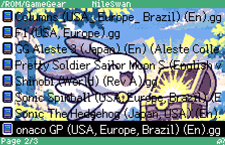

SwanShellDX is **not** the official swanshell: for that, see
[asiekierka/swanshell](https://github.com/asiekierka/swanshell). Please do not
report SwanShellDX problems to the swanshell project.

## What it adds

### Emulator plugins

Files of these systems are started from the menu like WonderSwan games. Each
plugin is a file in `/NILESWAN` on the microSD card.

| Plugin | System | Files |
|---|---|---|
| `PLUG_GG.BIN` (ggswan) | Sega Game Gear | `.gg` (up to 1 MiB) |
| `PLUG_SMS.BIN` (smsswan) | Sega Master System | `.sms` (Codemasters mapper too) |
| `PLUG_SG.BIN` (sgswan) | Sega SG-1000 | `.sg` |
| `PLUG_SF.BIN` (sfswan) | Sega SC-3000 with the SF-7000 disk unit | `.sf` disk images |
| `PLUG_GB.BIN` (gbswan) | Nintendo Game Boy | `.gb` (MBC1, MBC2, MBC3 with its clock, MBC5) |

How they work:
- The Z80 plugins (Game Gear, Master System, SG-1000, SF-7000) and the Game
  Boy plugin run the game's CPU through a dynamic recompiler: Z80 or Game Boy
  code is translated to V30MZ code as it runs.
- The video chips are mapped onto the WonderSwan's own tiles, screens and
  sprites, and the sound onto its sound channels.

What they offer:
- Battery saves (`.sav` next to the ROM).
- Save states (`.st0` next to the ROM): START + A held to save, START + B held
  to load.
- An on-screen menu (START + Y3 (Y down)) with video, audio, state and option
  pages; the options are saved for the plugin or for one game.
- START + Y1 (Y up) back to the menu.
- On the start screen, the times of the card mount, the ROM read and the
  set-up.

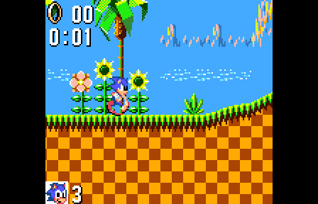
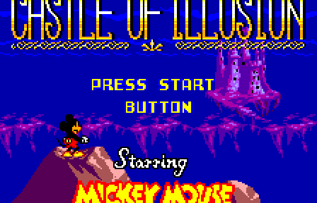
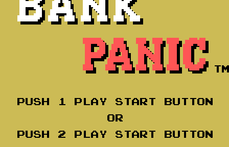
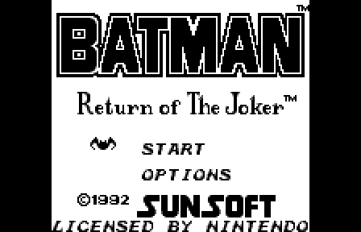

The on-screen menu (START + Y3 (Y down)):

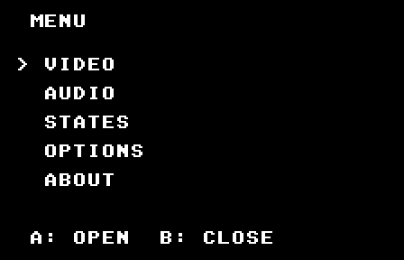

The SF-7000 plugin needs a disk with Disk BASIC on it, copied as
`/NILESWAN/SF7000.SF` (not included).

The plugins and how they are made are described in
[src/ggswan/README.md](src/ggswan/README.md) and the documents next to it.

### Back to the menu from WonderSwan games (START + Y1)

With *Settings > System > Advanced > START+Y1 back to menu* on, holding
START + Y1 (Y up) in a WonderSwan or WonderSwan Color game resets to the menu,
keeping the game's save. The game's key-reading routine is patched when the
game is launched:
- by a patch file for that game from `/NILESWAN/PATCHES` (`.Y1P`), when
  there is one;
- otherwise by searching the ROM for the usual forms of that routine.

The patch files are made with [SwanShell_RebootPatcher](https://github.com/mariovirgili/SwanShell_RebootPatcher),
which also ships the database of patches for the games that need one of their
own.

### Menu

- **Game pictures:** screenshots and a thumbnail for each game, in
  `/NILESWAN/IMAGES/<ROM name>/` (`1.bmp`, `2.bmp`, ... and `thumb.bmp`). There
  is a viewer, a preview and an indicator in the list. Make them with
  [SwanShell_ImageBuilder](https://github.com/mariovirgili/SwanShell_ImageBuilder).
- **Icon sets** chosen from the card (*Theme > Icons*, `/NILESWAN/ICONS/*.ICN`).
  Make and edit them with [SwanShell_IconEditor](https://github.com/mariovirgili/SwanShell_IconEditor).
- **Wallpapers** chosen from the card (`/NILESWAN/WALLPAPERS`, 224x144 BMP).
- **Menu music** with volume and on/off. A track of the VGM player can be
  used as menu music, or `/NILESWAN/MENU.VGM`. The VGM player gained `.vgz`,
  PCM, auto-advance, shuffle, position and time.
- **Finding games:**
  - favorites and recent games;
  - a most played list (launch count and last date);
  - letter jump;
  - extensions shown;
  - a ROM index for faster listing of large folders.
- **Back where you left off:**
  - *Last directory* puts the cursor on the last game opened;
  - hold Y1 (Y up) at start-up to launch the last recent game.
- **Long names** scroll pixel by pixel, at a speed you set.
- **IPS and BPS patches** applied on the fly at launch.
- **ROM info:** header details, publisher and checksum check.
- **Save backups** in `/NILESWAN/SAVES`, made at launch, with restore and erase.
- **Help:** a page after *Settings* in the START menu, with the keys of the
  plugin of the selected file.
- **Other options:** hide the `NILESWAN` folder, hide save files, and a
  low-battery warning at start-up.

Game pictures: the thumbnail in the list, and the viewer (Y3 (Y down), or
*Images* in the START menu):

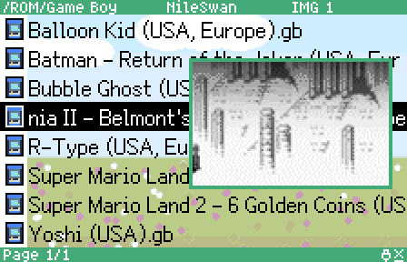
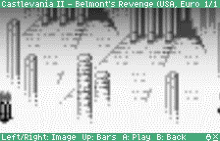

The START menu and the Help page with the keys of the selected file's plugin:

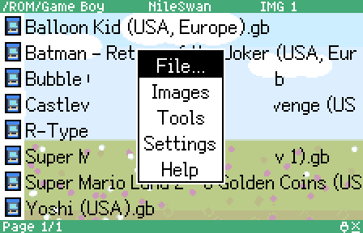
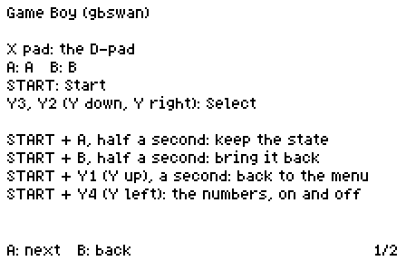

The VGM player: the track's text, its position and time; Start chooses
next, shuffle or repeat, or makes the track the menu music:

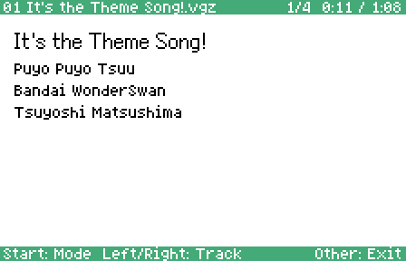
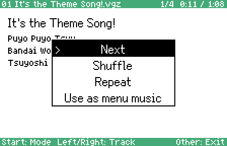

Theme: wallpapers and icon sets from the card, with a preview:

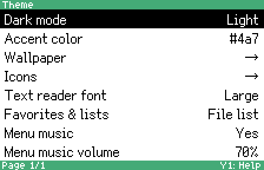
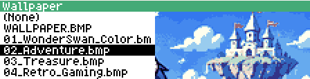
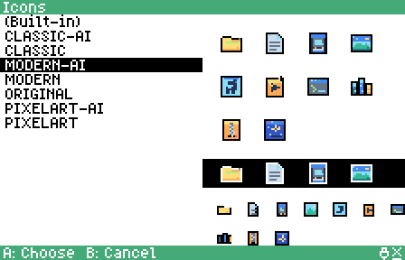

## Tools

Three Windows tools make the files that SwanShellDX reads from the card.

### SwanShell_ImageBuilder

[SwanShell_ImageBuilder](https://github.com/mariovirgili/SwanShell_ImageBuilder)
takes the game names from your ROM folders and the pictures from your image
folders (or from the internet), converts them to the format the menu reads
(224x144 pictures and 112x72 thumbnails, 16 colours) and writes them to
`/NILESWAN/IMAGES`.

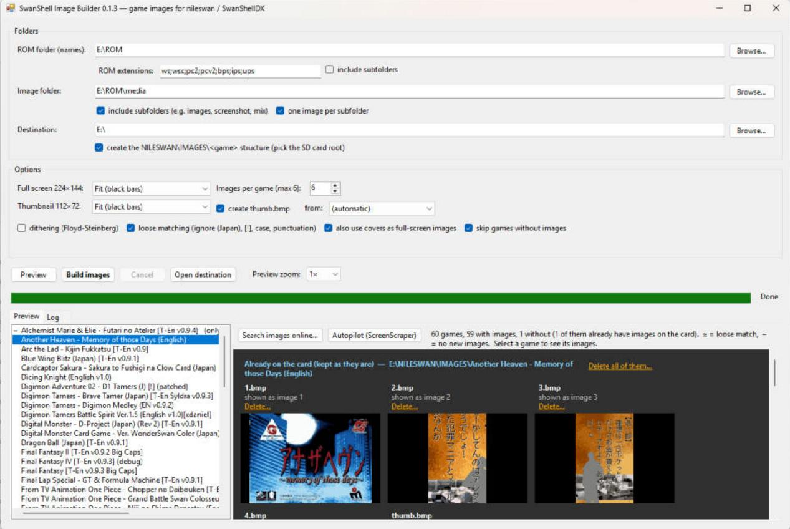

### SwanShell_RebootPatcher

[SwanShell_RebootPatcher](https://github.com/mariovirgili/SwanShell_RebootPatcher)
makes the START + Y1 patch files (`.Y1P`) for `/NILESWAN/PATCHES`, checking each
one in an emulated test. A list of ROMs, from files or folders, is patched in
one go.

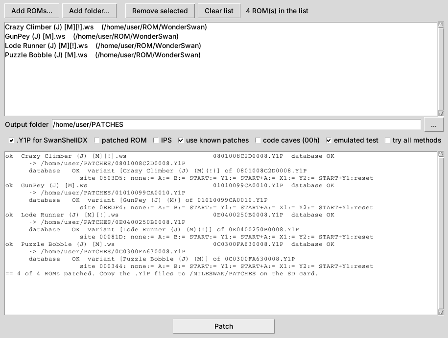

### SwanShell_IconEditor

[SwanShell_IconEditor](https://github.com/mariovirgili/SwanShell_IconEditor)
draws and edits icon sets (`.ICN`) for *Theme > Icons*, with a preview as on the
console in color and mono, 16x16 and 8x8.

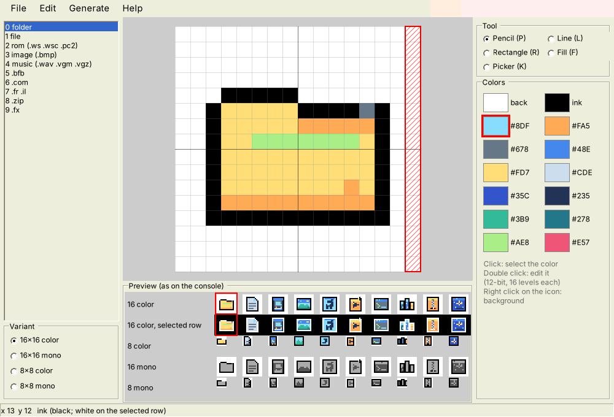

## Installation

1. Get the files: build them (below), or take them from a release when there
   is one.
2. Copy the contents of `dist/` to the root of the nileswan's microSD card
   (FAT32). This gives the menu, the BIOS files, the fonts and the plugins in
   `/NILESWAN`.
3. Optional:
   - patch files in `/NILESWAN/PATCHES`, from
     [SwanShell_RebootPatcher](https://github.com/mariovirgili/SwanShell_RebootPatcher);
   - pictures in `/NILESWAN/IMAGES`;
   - icon sets in `/NILESWAN/ICONS`;
   - wallpapers in `/NILESWAN/WALLPAPERS`.
4. Put your ROMs anywhere on the card.

## Building

Requirements, as for swanshell:

- [Wonderful Toolchain](https://wonderful.asie.pl/wiki/doku.php?id=getting_started)
  - `wf-pacman -S target-wswan wf-superfamiconv wf-zx0-salvador`
- Python >= 3.11 + uv

Then:

    git submodule update --init --recursive
    make          # the menu and the five plugins
    make dist     # also the BIOS files, fonts and licences, in dist/

`make plugin-ggswan` builds only the plugins.

## Credits

- **swanshell**: Adrian "asie" Siekierka and the swanshell contributors.
  SwanShellDX is built on swanshell, and its translations come from
  swanshell's [Weblate](https://weblate.asie.pl/projects/49bitcat/swanshell/).
- **nileswan**: the cartridge, its firmware, libnile and nileswan-medem, by
  [49bitcat](https://49bitcat.com/). The reset
  code that the START+Y1 patches put in games follows libnile's
  `nile_soft_reset`.
- **AthenaOS** (the BIOS files) and **uxnws** (`PLUG_UXN.BIN`): asie.
- **Wonderful Toolchain**: asie.
- **Game Boy MBC3 clock**: the registers' behaviour follows
  [Peanut-GB](https://github.com/deltabeard/Peanut-GB) by Mahyar Koshkouei
  (MIT licence).
- **Plugins' PSG sound**: follows the SN76489 driver of swanshell's VGM player
  (asie, zlib licence).
- **Fonts**: Misaki, Boutique bitmap, M+, Baekmuk and Ark Pixel, under their
  own licences (in `fonts/` and `vendor/`; in a build, in `/NILESWAN/license`).
- **SwanShellDX**, the plugins and the tools above: Gio-74, made with Claude
  (Anthropic). Some optimisation proposals came from Gemini and ChatGPT and
  were verified and measured before going in.

## License

- `docs/`: CC BY-SA 4.0. The screenshots in `docs/images` show games and
  pictures that belong to their owners; they are there only to show
  SwanShellDX at work.
- `src/`: GPLv3
- Fonts and vendored components: their own licences (see `fonts/`, `vendor/`
  and `docs/license`).
